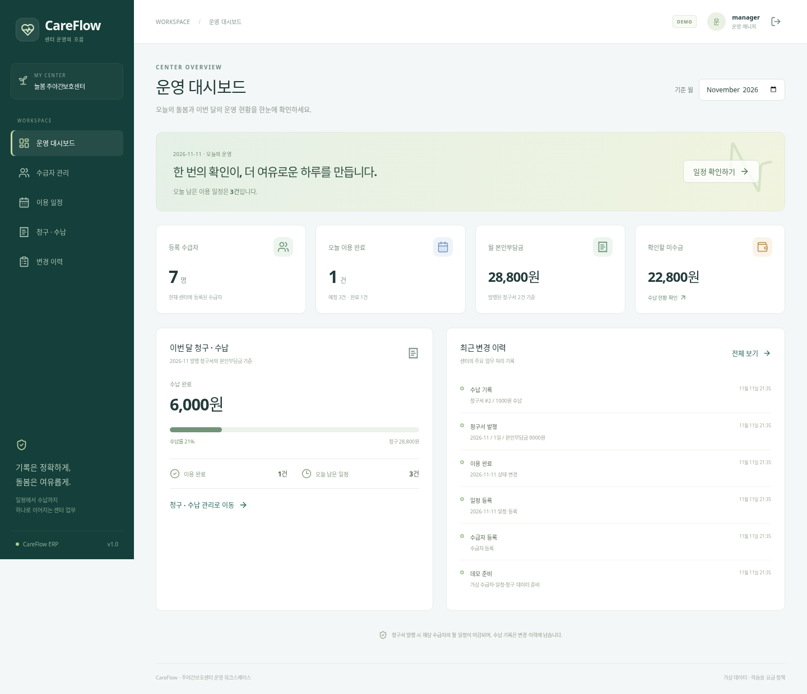

# CareFlow ERP

**주야간보호센터의 이용 일정 → 월 청구 → 본인부담금 수납을 연결하는 풀스택 포트폴리오.**

기웅정보통신 이지케어 개발자 공고의 Spring Boot·Vue 3·관계형 DB·SQL 최적화·운영 문서화 요구사항을 바탕으로 만든 독립 학습 프로젝트입니다. 회사의 소스나 화면을 복제하지 않았으며, 모든 수급자 정보와 요금은 가상입니다.



실제 실행 화면: [청구·수납](docs/images/billing.png) · [모바일 대시보드](docs/images/dashboard-mobile.png)

## 구현 범위

| 화면 | 실제 동작 |
|---|---|
| 운영 대시보드 | 센터별 수급자 수, 오늘 일정, 월 청구·수납·미수금 집계 |
| 수급자 관리 | 이름 검색·페이지 조회·등록, 일 이용료·본인부담률 설정 |
| 이용 일정 | 월·이름·상태 조회, 일정 등록, 이용 완료·취소 |
| 청구·수납 | 완료 이용 내역의 월 청구서 발행, 요금 스냅샷 조회, 부분 수납·재시도 |
| 변경 이력 | 담당자·처리 시각·변경 내용 조회, 업무 변경과 함께 트랜잭션 저장 |

가장 중요한 검증 대상은 **중복 청구, 재시도에 의한 중복 수납, 동시 수납에 의한 초과 반영, 센터 간 데이터 노출**입니다. 화면의 숫자는 API와 PostgreSQL 조회 결과를 사용합니다.

## 기술 구성

| 구분 | 사용 기술 | 역할 |
|---|---|---|
| 백엔드 | Java 17, Spring Boot 3.5.16 | REST API, 트랜잭션, 입력 검증 |
| 인증·권한 | Spring Security, 서버 세션, CSRF | 운영/조회 역할, 서버에서 센터 범위 결정 |
| 데이터 접근 | Spring Data JPA, QueryDSL 5.1 | 변경 저장, 잠금, 동적 조회·DTO 투영 |
| 데이터베이스 | PostgreSQL, Flyway | 고유 제약·복합 외래키·인덱스·스키마 버전 관리 |
| 프론트엔드 | Vue 3, TypeScript, Pinia, Vue Router, Vite | 업무 화면, 인증 상태, 라우팅, API 연결 |
| 검증 | JUnit 5, MockMvc, embedded PostgreSQL, Vitest, Playwright | 도메인·DB·권한·동시 요청·브라우저 흐름 |
| 실행·자동화 | Maven Wrapper, Docker Compose, GitHub Actions | 재현 가능한 빌드·시연·검증 |

구현하지 않은 기술을 스택에 포함하지 않았습니다. 공고에 언급된 ORM을 실제 청구·수납에 적용하고, QueryDSL은 일정 검색·청구서 검색·월 집계에 사용합니다.

## 가장 간단한 실행: Docker Desktop

Docker Compose v2가 필요합니다. Windows에서도 아래 명령을 사용할 수 있습니다.

```bash
git clone https://github.com/shawwwnie/Attendance.git careflow-erp
cd careflow-erp
docker compose up --build
```

브라우저에서 **http://localhost:4173**을 여세요. 첫 빌드와 DB 초기화에는 시간이 걸립니다. 종료는 `Ctrl+C`, 백그라운드 실행은 `docker compose up --build -d`, 로그 확인은 `docker compose logs -f api`입니다.

| 아이디 | 기본 비밀번호 | 권한·소속 |
|---|---|---|
| `manager` | `careflow-demo` | 늘봄 센터 · 조회·변경 |
| `viewer` | `careflow-demo` | 늘봄 센터 · 조회 전용 |
| `other-manager` | `careflow-demo` | 다온 센터 · 조회·변경 |

`.env.example`을 `.env`로 복사해 데모 비밀번호를 바꿀 수 있습니다. 로그인 화면에 표시되는 초기 비밀번호는 기본값 안내이므로 변경한 값을 직접 입력하세요.

Compose의 웹 포트는 로컬호스트에만 열려 있습니다. PostgreSQL 데이터는 `careflow-db` 볼륨에 유지되며 샘플 데이터는 처음 한 번만 생성합니다.

## Docker 없이 빠르게 시연

Linux/macOS에서 **JDK 17 이상**, **Node.js 22.18 이상(24 권장)**과 네트워크 연결이 필요합니다. 임시 PostgreSQL 실행 파일은 테스트 의존성으로 내려받습니다. root 계정에서 실행하지 마세요.

```bash
./scripts/dev.sh
```

**http://localhost:5173**에서 같은 데모 계정으로 로그인합니다. 이 경로는 테스트 전용 PostgreSQL을 사용하므로 종료 후 데이터가 삭제됩니다. `LocalDemoServer`는 운영 JAR에 포함되지 않습니다.

직접 설치한 PostgreSQL을 사용하려면:

```bash
# 먼저 careflow DB와 접속 계정을 준비합니다.
export DB_URL=jdbc:postgresql://localhost:5432/careflow
export DB_USERNAME=careflow
export DB_PASSWORD=your-local-password
cd backend
./mvnw spring-boot:run -Dspring-boot.run.profiles=demo
```

별도 터미널:

```bash
cd frontend
npm ci
npm run dev
```

Windows PowerShell에서는 환경변수를 `$env:DB_URL="..."` 형식으로 지정하고 `mvnw.cmd`를 사용합니다. 임시 PostgreSQL 시연 스크립트 대신 Docker Desktop 또는 직접 설치한 PostgreSQL을 권장합니다.

## 5분 시연 순서

1. `manager`로 로그인하고 대시보드의 실제 집계 값을 확인합니다.
2. **수급자 관리 → 수급자 등록**에서 가상 수급자를 등록합니다. 기본 요금은 일 60,000원, 부담률 15%입니다.
3. **이용 일정 → 일정 등록**에서 오늘 날짜로 일정을 등록하고 **이용 완료**를 누릅니다.
4. **청구·수납 → 청구서 발행**에서 같은 수급자를 선택합니다. 완료 1일이면 본인부담금은 9,000원입니다.
5. 청구서 상세에서 1,000원을 수납 기록합니다. 미수금이 8,000원으로 바뀝니다.
6. 같은 수급자·같은 월로 다시 발행해 기존 청구서가 반환되는지 확인합니다.
7. **변경 이력**에서 등록·완료·청구·수납 기록을 확인합니다.
8. 로그아웃 후 `viewer`의 변경 버튼 제한과 `other-manager`의 별도 데이터 범위를 비교합니다.

청구 전에 해당 수급자의 월 예정 일정은 모두 완료 또는 취소해야 합니다. 발행된 월에는 새 일정을 추가하거나 상태를 바꿀 수 없습니다. 금액과 이용 내역이 뒤늦게 달라지는 것을 막기 위한 학습용 마감 규칙입니다.

## 데이터 정확성을 위한 설계

### 월 청구는 수급자 기준으로 직렬화

일정 등록·상태 변경·청구서 발행은 동일한 수급자 행에 `PESSIMISTIC_WRITE` 잠금을 먼저 획득합니다. 청구서에는 `(center_id, recipient_id, billing_month)` 고유 제약도 둡니다. 동시에 발행해도 한 건만 생성하고 후속 요청은 기존 청구서를 반환합니다.

### 수납은 요청 식별과 잔액 검증을 함께 사용

청구서 행을 잠근 뒤 `Idempotency-Key`를 확인합니다. 같은 키·같은 내용은 기존 수납 결과를 반환하고, 같은 키·다른 내용은 충돌로 처리합니다. 다른 키가 동시에 도착해도 잠금 안에서 미수금을 다시 계산하므로 초과 수납을 막습니다.

브라우저는 확인되지 않은 요청 키를 `sessionStorage`에 보관합니다. 통신 오류와 새로고침 후 같은 입력으로 재시도할 때 같은 키를 사용하고, 성공 응답을 받은 뒤 삭제합니다.

### 청구 내역은 발행 당시 가격으로 보존

일 이용료·본인부담률·일별 본인부담금을 `invoice_line`에 복사합니다. 수급자 요금 정보가 나중에 달라져도 발행된 청구서의 금액과 근거가 유지됩니다. 금액은 정수 원화이고 일별로 사사오입합니다.

### 센터는 요청 본문으로 선택하지 않음

서버 인증 사용자로 센터를 결정하고, 모든 조회·변경에 센터 조건을 적용합니다. 데이터베이스에도 `(id, center_id)` 복합 외래키를 둬 센터가 다른 행의 잘못된 연결을 차단합니다. 조회 전용 계정의 변경 API도 서버에서 거부합니다.

## 검증 실행

```bash
cd backend
./mvnw verify

cd ../frontend
npm ci
npm test
npm run build

# API와 프론트엔드가 실행된 상태에서:
npx playwright install chromium
npm run test:e2e
```

PostgreSQL 통합 테스트는 H2 대체 없이 실제 PostgreSQL 프로세스를 사용합니다. 스키마 마이그레이션, 보안 필터, HTTP API, 트랜잭션과 동시 요청을 검증합니다.

세부 실행 결과·환경·미검증 범위는 [검증 기록](docs/VERIFICATION.md)에 기록합니다. CI는 백엔드·프론트엔드 검사 후 브라우저 검증을 수행합니다.

## 문서

- [아키텍처·DB·설계 판단](docs/ARCHITECTURE.md)
- [API·오류 코드·권한](docs/API.md)
- [운영·장애 대응 매뉴얼](docs/RUNBOOK.md)
- [검증 결과](docs/VERIFICATION.md)
- [면접 설명·예상 질문·학습 순서](docs/INTERVIEW_GUIDE.md)

## 적용 범위와 남은 작업

실제 장기요양 수가·공단 청구·건강정보·급여 지급·은행 이체·앱 패킹은 구현 범위에 포함하지 않습니다. 센터 운영의 일부 흐름을 가상 요금으로 구현했습니다.

데모 인증은 메모리 계정과 고정 센터 매핑입니다. 기본 프로필에서는 데모 계정과 샘플 데이터를 생성하지 않으며, 실제 배포에는 영속 계정/소속 관리 또는 OIDC, HTTPS와 Secure 쿠키, 세션 공유·백업·복구 설계가 필요합니다. 청구 취소·정정·환불도 별도 업무 규칙이 필요한 후속 과제입니다.

공고를 바탕으로 AI와 함께 구현·검증한 학습용 프로젝트입니다. 면접에서는 실제 업무 경력과 이 프로젝트의 학습·검증 범위를 구분해 설명합니다.

## 참고한 공식 문서

- [지원 공고](https://www.wanted.co.kr/wd/396995)
- [Spring Boot 시스템 요구사항](https://docs.spring.io/spring-boot/3.5/system-requirements.html)
- [Spring Data JPA와 QueryDSL](https://docs.spring.io/spring-data/jpa/reference/repositories/core-extensions.html)
- [Vue 시작하기](https://vuejs.org/guide/quick-start.html)
- [Spring Security CSRF](https://docs.spring.io/spring-security/reference/servlet/exploits/csrf.html)
- [PostgreSQL 명시적 잠금](https://www.postgresql.org/docs/current/explicit-locking.html)
