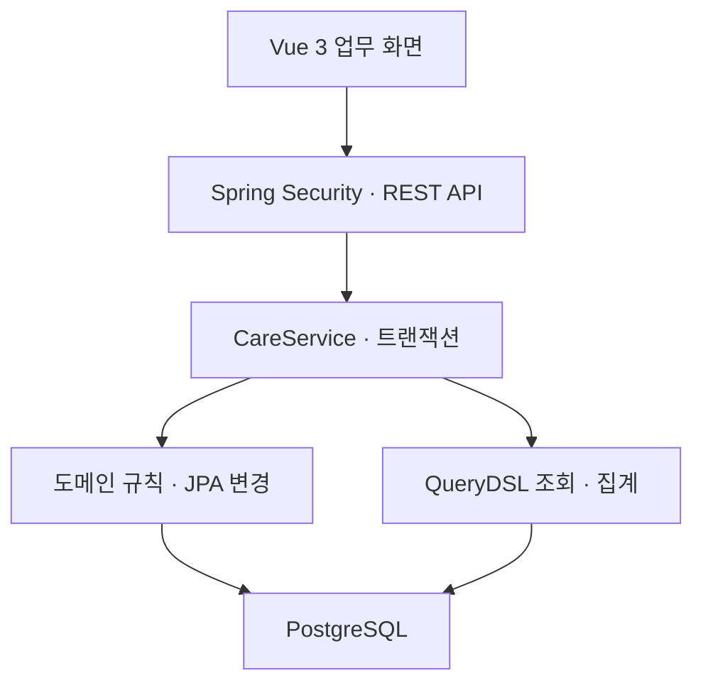
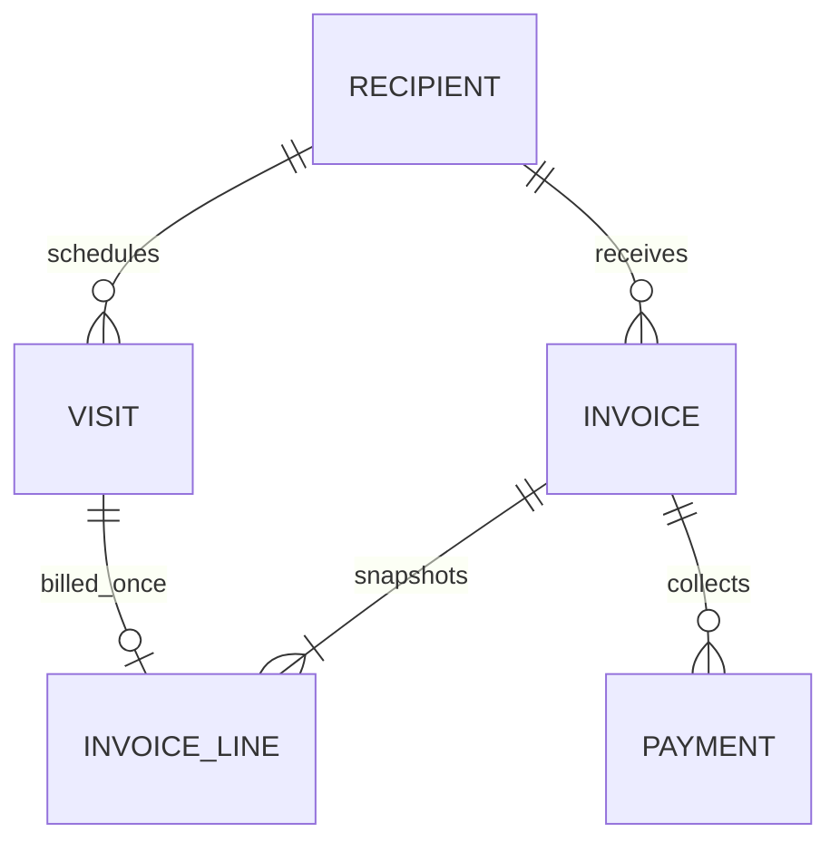

# CareFlow 설계 설명

## 업무 흐름과 경계

이 프로젝트는 기존 Spring MVC·MyBatis·JSP 경험에서 Spring Boot·JPA·Vue로 이어지는 학습을 위해 설계했습니다. 규모가 작은 상태에서 업무 트랜잭션을 이해할 수 있도록 하나의 API 애플리케이션 안에서 도메인과 조회 책임을 나눴습니다.



| 위치 | 책임 |
|---|---|
| `api/` | JSON 계약, Bean Validation, HTTP 상태, 권한 경계 |
| `service/` | 인증 센터 범위, 업무 순서, 잠금, 트랜잭션, 감사 기록 |
| `domain/` | 금액 계산, 이용 상태 전이, 미수금·초과 수납 규칙 |
| `repository/` | JPA 변경·잠금, QueryDSL 필터·DTO 투영 |
| `security/` | 세션 인증, CSRF, 데모 사용자와 센터 매핑 |
| `common/` | 오류 계약, 요청 ID, 예외 응답 |
| `frontend/src/views/` | 업무 단위 화면과 사용자 입력 |
| `frontend/src/lib/` | API, 표시 형식, 수납 재시도 키 |

## 주요 테이블



모든 업무 테이블은 `center_id`를 갖습니다. 서비스 계층의 센터 조건과 DB의 복합 외래키를 함께 사용합니다. `audit_event`는 변경 대상 유형·ID와 작업자를 기록하며, 업무 데이터와 같은 트랜잭션으로 저장합니다.

## 잠금과 중복 방지

### 청구 마감과 일정 변경의 경쟁

`(센터, 수급자)`를 공통 잠금 단위로 정했습니다.

1. 수급자 행에 배타 잠금을 획득합니다.
2. 해당 월의 청구서 존재 여부를 확인합니다.
3. 일정 변경 또는 청구서 생성을 수행합니다.
4. 감사 이력과 함께 커밋합니다.

일정 변경은 잠금 획득 전에 읽었던 엔티티를 `refresh`합니다. 잠금을 기다리는 동안 다른 트랜잭션이 상태를 변경했을 수 있기 때문입니다.

청구서는 월 예정 일정이 0건이고 완료 일정이 1건 이상일 때 생성됩니다. 취소 일정은 청구 대상에서 제외됩니다. 동일한 월·수급자 발행은 기존 결과를 반환합니다.

이 방식은 동일 수급자의 서로 다른 달 변경까지 직렬화합니다. 현재 범위에서는 이해하기 쉬운 일관성을 우선했습니다. 쓰기량이 커지면 별도의 `recipient_month` 마감 행으로 잠금 범위를 줄일 수 있습니다.

### 수납 동시성과 멱등성

청구서 잠금을 획득한 뒤 다음 순서로 처리합니다.

1. 센터 범위의 `Idempotency-Key` 조회.
2. 기존 키와 청구서 ID·금액·정규화한 메모가 같으면 기존 수납 반환.
3. 내용이 다르면 409.
4. 새 요청이면 양수·잔액 이하 금액인지 검사.
5. 청구서 누적 수납액, 수납 행, 감사 이력을 한 번에 저장.

네트워크의 응답 유실과 서로 다른 요청의 동시 실행은 다른 문제입니다. 요청 키는 재시도를 식별하고, 청구서 잠금은 독립 요청이 같은 잔액을 중복 소비하는 것을 막습니다. DB 고유 제약은 애플리케이션 검사 외에 최종 제약으로 작동합니다.

### 여러 서버로 확장할 때

이 잠금은 JVM 메모리 락이 아니라 PostgreSQL 행 잠금입니다. 같은 DB를 사용하는 여러 API 인스턴스에도 적용됩니다. 다만 세션은 현재 애플리케이션 메모리에 있으므로 다중 인스턴스 인증에는 세션 공유 등이 별도로 필요합니다. 요청량·잠금 대기시간·커넥션 풀 사용량을 측정한 뒤 확장 방식을 결정해야 합니다.

## 정수 원화와 가격 스냅샷

부담률은 basis point 단위입니다. `1500`은 `15%`입니다.

```text
일별 본인부담금 = (일 이용료 × 부담률 + 5000) / 10000의 정수 몫
월 본인부담금 = 일별 본인부담금의 합
```

예: 60,000원 × 15% = 9,000원. 1,005원 × 15% = 150.75원이므로 일별 151원입니다. 부동소수점 대신 정수와 `Math.multiplyExact`를 사용합니다. 요금·부담률·계산 결과를 청구서 항목에 저장해 재계산에 따른 과거 금액 변경을 막습니다.

실제 수가·가산·감경·본인부담상한 등을 구현한 공식 계산기가 아닙니다.

## 조회와 인덱스

일정 조회는 `center_id`와 월 시작/끝 날짜로 범위를 제한하고, 선택한 상태와 이름 조건을 QueryDSL에 추가합니다. `VisitView`로 필요한 필드만 투영하고 수급자 이름을 한 번의 JOIN으로 가져옵니다. OSIV는 비활성화했습니다.

| 인덱스·제약 | 목적 |
|---|---|
| `visit(center_id, service_date, status)` | 센터·날짜 범위와 상태 조회 |
| `UNIQUE visit(center_id, recipient_id, service_date)` | 같은 수급자의 일별 중복 일정 방지 |
| `UNIQUE invoice(center_id, recipient_id, billing_month)` | 월 중복 청구 방지 |
| `UNIQUE invoice_line(visit_id)` | 하나의 이용을 여러 청구서에 포함하는 오류 방지 |
| `invoice(center_id, billing_month)` | 월별 청구 조회·집계 |
| `UNIQUE payment(center_id, idempotency_key)` | 재시도 식별 |
| `audit_event(center_id, created_at DESC, id DESC)` | 센터별 최근 이력 조회 |

샘플 데이터에서 인덱스의 성능 개선 수치를 주장하지 않습니다. 적은 데이터에는 순차 스캔이 유리할 수 있습니다. 실무 튜닝은 대표 데이터·조건을 준비하고 `EXPLAIN (ANALYZE, BUFFERS)`와 전체 API 지연을 함께 확인해야 합니다.

## 운영 추적성

- API 오류는 `code`, `message`, `requestId`, `fieldErrors`로 통일합니다.
- `X-Request-ID`를 응답하고 로그 MDC에도 넣습니다.
- 실패한 수납은 수납 행·누적 수납액·성공 감사 이력을 남기지 않습니다.
- 비밀번호·실제 개인정보를 감사 상세에 기록하지 않습니다.
- 프론트엔드는 로딩·빈 결과·실패·재시도 상태를 구분합니다.

## 의도적으로 남겨둔 경계

후속 과제는 실제 권한/소속 저장, 요금 변경 이력, 청구 취소·정정·환불과 회계 분개, 직원 급여, 실사용 데이터 이관, 실서비스 관측·성능 기준입니다. 구현되지 않은 내용을 실서비스 수준으로 표현하지 않습니다.
